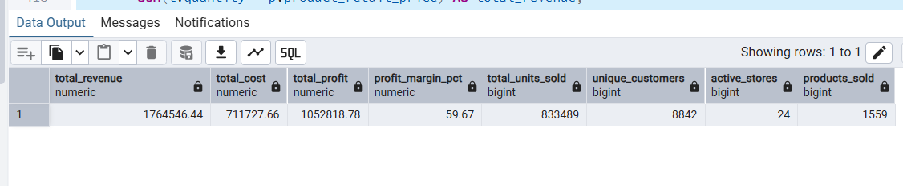
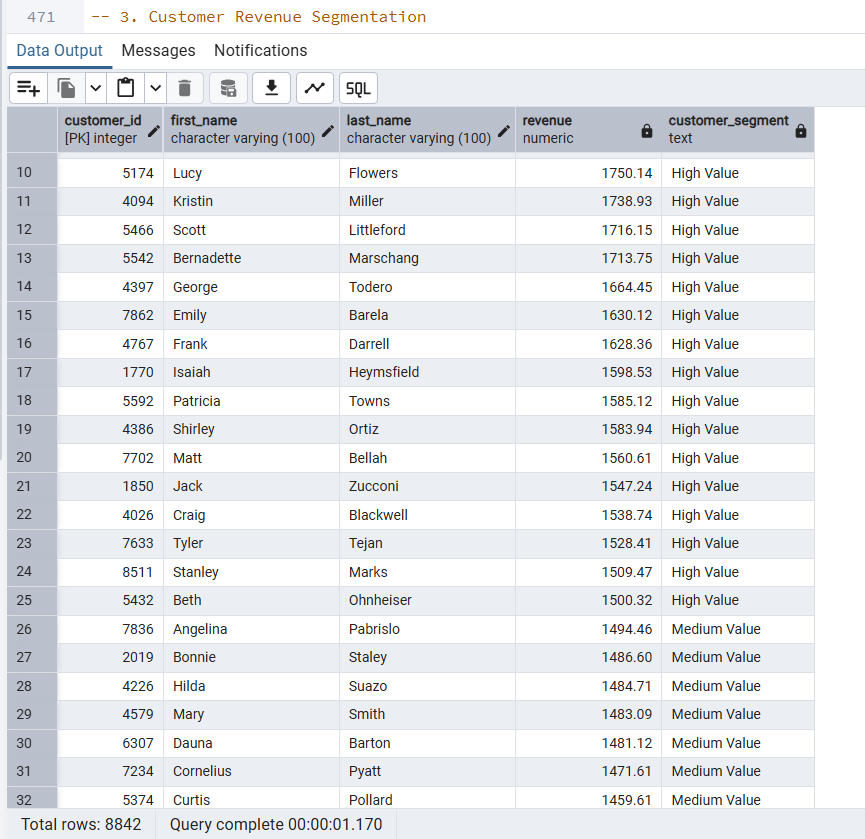
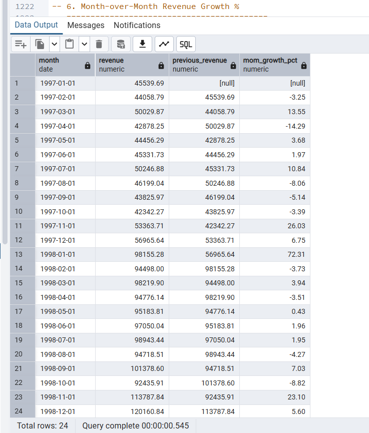
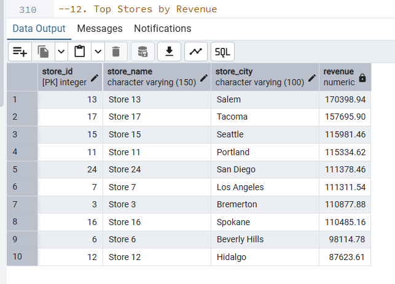

# Retail Business SQL Analytics

## Project Overview

This project analyzes a **multi-store retail business** using **PostgreSQL** and SQL.

The dataset contains customer, product, store, regional, transaction, return, and calendar information. The goal of the project is to use relational SQL analysis to evaluate **sales performance, profitability, customer activity, product and brand performance, store and regional performance, monthly growth, and return behavior**.

The project progresses from core KPIs to intermediate analysis, CTEs and subqueries, advanced window functions, and returns analysis.

---

## Business Context

The dataset represents a retail business operating across multiple stores and sales regions.

The analysis focuses on questions such as:

- How much revenue, cost, and gross profit did the business generate?
- Which products, brands, stores, customers, and regions perform best?
- How is customer value distributed?
- Which stores and products perform above average?
- How does revenue change over time?
- Which months show the strongest and weakest growth?
- Which stores lead within their regions?
- Which products and stores show higher return activity?
- What is the estimated retail value associated with returned merchandise?

The purpose is to turn relational retail data into business insights that can support decisions related to **customer strategy, product strategy, store performance, regional growth, and operational improvement**.

---

## Tools & Technologies

- **PostgreSQL**
- **pgAdmin 4**
- **SQL**
- Relational data modeling
- Multi-table joins
- CTEs
- Subqueries
- Window functions

---

## Dataset & Data Model

The project uses the **Maven Market retail dataset**, organized into multiple related tables:

- `customers`
- `products`
- `stores`
- `regions`
- `transactions`
- `returns`
- `calendar`

The `transactions` table acts as the main fact table and links to customer, product, and store data.

### Simplified Relationship Structure

```text
customers
   │
   └── customer_id
           │
           ▼
      transactions
       │   │   │
       │   │   └── store_id ─────► stores ─────► regions
       │   └────── product_id ───► products
       └────────── transaction_date

returns
   │
   ├── product_id ────────────────► products
   └── store_id ──────────────────► stores
```

---

## Data Scope & Analytical Assumptions

To keep the analysis transparent and reproducible, the following assumptions were used:

- Revenue was calculated as:

```text
Revenue = Quantity × Product Retail Price
```

- Gross profit was calculated as:

```text
Gross Profit = Quantity × (Product Retail Price − Product Cost)
```

- The dataset does **not contain an invoice/order ID**, so a true order-level Average Order Value (AOV) was not calculated.
- Customer repeat activity was measured using the number of transaction records per customer. Therefore, the repeat-customer result should be interpreted as a **repeat-transaction activity proxy**, not a confirmed distinct-order retention metric.
- Customer segmentation thresholds were **project-defined analytical thresholds**, not official business rules:
  - High Value: Revenue ≥ 1,500
  - Medium Value: Revenue ≥ 750 and < 1,500
  - Low Value: Revenue < 750
- Estimated return value was calculated using returned quantity × product retail price. It should **not** be interpreted as confirmed lost revenue because the dataset does not provide full refund, replacement, or return-resolution information.
- Return-rate calculations compare aggregate returned units with aggregate sold units over the available period.

---

## Project Workflow

The analysis was completed in five analytical sections:

1. **Core Business Analysis**
2. **Intermediate Customer, Product & Store Analysis**
3. **CTE & Subquery Analysis**
4. **Advanced SQL / Window Functions**
5. **Returns & Business Performance Analysis**

The final stage summarizes findings, recommendations, and portfolio documentation.

---

# Section 1 — Core Business Analysis

## Key KPIs

| KPI | Result |
|---|---:|
| **Total Revenue** | **1,764,546.44** |
| **Total Cost** | **711,727.66** |
| **Total Gross Profit** | **1,052,818.78** |
| **Gross Profit Margin** | **59.67%** |
| **Total Units Sold** | **833,489** |
| **Unique Customers** | **8,842** |
| **Active Stores** | **24** |
| **Products Sold** | **1,559** |

### Interpretation

The business generated approximately **1.76M in revenue** and **1.05M in estimated gross profit**, resulting in a **59.67% gross margin** based on the retail price and product cost fields in the dataset.

The dataset also covers **24 active stores**, **8,842 unique customers**, and **1,559 products**, providing enough breadth for multi-dimensional SQL analysis.

## Key KPIs


---

# Section 2 — Intermediate Business Analysis

## Customer Activity

### Repeat vs One-Time Transaction Activity

| Customer Type | Customer Count |
|---|---:|
| **Repeat-Activity Customers** | **8,735** |
| **One-Record Customers** | **107** |

Because the dataset does not contain a distinct order ID, this result is based on transaction-record frequency rather than confirmed repeat orders.

## Customer Segmentation

| Segment | Customer Count |
|---|---:|
| **High Value** | **25** |
| **Medium Value** | **365** |
| **Low Value** | **8,452** |

A total of **2,618 customers** generated revenue above the average customer revenue level.

### Interpretation

The customer base is heavily concentrated in the low-value segment under the project-defined thresholds. Only a small number of customers fall into the high-value segment, making them important candidates for retention and relationship-management strategies.

## Customer Segmentation


---

# Section 3 — CTE & Subquery Analysis

CTEs and subqueries were used to answer multi-step business questions such as:

- Customers above average revenue
- Products above average revenue
- Stores above average profit
- Top 10% of customers by revenue
- Customer revenue contribution
- Products with above-average profit
- Best store in each region
- Products sold in more stores than average
- Customers with above-average transaction frequency
- Regions contributing above-average revenue

This section demonstrates the ability to break larger analytical problems into reusable SQL steps.

---

# Section 4 — Advanced SQL & Window Functions

## Techniques Used

- `RANK()`
- `DENSE_RANK()`
- `ROW_NUMBER()`
- `LAG()`
- `PARTITION BY`
- Running totals
- Month-over-month growth
- Revenue contribution percentages
- Store performance versus regional benchmarks

## Key Results

- **Highest MoM growth:** January 1998 — **72.31%**
- **Lowest MoM growth:** April 1997 — **-14.29%**
- **Final running revenue:** **1,764,546.44**

The final cumulative revenue matches the overall revenue KPI, providing a useful validation check.

### Top Store Within Each Region

| Region | Top Store | Revenue |
|---|---|---:|
| **North West** | Store 13 | **170,398.94** |
| **South West** | Store 24 | **111,378.46** |
| **Mexico Central** | Store 12 | **87,623.61** |
| **Mexico South** | Store 8 | **87,253.65** |
| **Canada West** | Store 19 | **85,262.31** |
| **Mexico West** | Store 1 | **56,396.78** |
| **Central West** | Store 14 | **9,324.94** |

## Advanced SQL Highlight


---

# Section 5 — Returns & Business Performance Analysis

## Returns KPIs

| KPI | Result |
|---|---:|
| **Total Returned Quantity** | **8,289** |
| **Total Return Records** | **7,087** |
| **Estimated Return Value** | **17,432.40** |

## Most Returned Products

1. **Hermanos Red Pepper** — 17 returned units
2. **Hermanos Oranges** — 15
3. **Walrus Merlot Wine** — 15
4. **Super Creamy Peanut Butter** — 14
5. **Tell Tale Cauliflower** — 14

## Highest Store Return Rates

| Store | Return Rate |
|---|---:|
| **Store 8** | **1.17%** |
| **Store 20** | **1.14%** |
| **Store 23** | **1.12%** |
| **Store 12** | **1.10%** |
| **Store 16** | **1.06%** |

### Interpretation

Return rates are relatively low compared with overall sales volume, but stores and products with comparatively higher return activity should be monitored for potential quality, handling, fulfillment, or customer-expectation issues.

---

# Top Performance Highlights

## Top Products by Revenue

1. **Hermanos Green Pepper** — 2,489.70
2. **Hilltop Mint Mouthwash** — 2,447.12
3. **Carlson Head Cheese** — 2,417.73
4. **Great Pumpernickel Bread** — 2,408.56
5. **Fabulous Strawberry Drink** — 2,377.90

Revenue among the leading products is relatively close, suggesting that no single product overwhelmingly dominates product-level revenue.


## Top Customers by Revenue

1. **Ida Rodriguez** — 2,235.43
2. **James Horvat** — 2,121.31
3. **Dawn Laner** — 1,995.21
4. **Mary Francis Benigar** — 1,973.79
5. **Wildon Cameron** — 1,955.25

## Top Stores by Revenue

1. **Store 13 — Salem:** 170,398.94
2. **Store 17 — Tacoma:** 157,695.90
3. **Store 15 — Seattle:** 115,981.46
4. **Store 11 — Portland:** 115,334.62
5. **Store 24 — San Diego:** 111,378.46

## Top Stores by Revenue



## Revenue by Region

| Region | Revenue |
|---|---:|
| **North West** | **847,826.72** |
| **Mexico Central** | **330,362.03** |
| **South West** | **320,804.78** |
| **Canada West** | **107,674.34** |
| **Mexico South** | **87,253.65** |
| **Mexico West** | **61,299.98** |
| **Central West** | **9,324.94** |

The **North West** region is the dominant revenue contributor in the dataset.

## Regional Revenue Performance

---

# Profitability Highlights

## Top Profitable Products

1. **Hermanos Green Pepper** — 1,670.55
2. **Imagine Popsicles** — 1,513.89
3. **Hilltop Mint Mouthwash** — 1,493.96
4. **Super Extra Chunky Peanut Butter** — 1,484.73
5. **Nationeel Potato Chips** — 1,479.50

## Top Brands by Profit

| Brand | Profit |
|---|---:|
| **Hermanos** | **33,167.27** |
| **Tell Tale** | **29,925.59** |
| **Ebony** | **29,749.45** |
| **Tri-State** | **29,064.76** |
| **High Top** | **28,502.83** |

---

# Key Business Findings

1. The business generated approximately **1.76M in revenue** and **1.05M in estimated gross profit**, with a **59.67% gross profit margin**.
2. Customer activity is highly recurring at the transaction-record level: **8,735 customers** have multiple transaction records, while only **107 customers** appear once.
3. Customer value is highly uneven under the project segmentation thresholds: **25 high-value**, **365 medium-value**, and **8,452 low-value** customers.
4. **2,618 customers** generated above-average customer revenue.
5. The **North West** region dominates sales performance with approximately **847.8K** in revenue.
6. **Store 13 in Salem** is the highest-revenue store overall at approximately **170.4K**.
7. **Hermanos Green Pepper** is both the highest-revenue product and the most profitable product in the reported rankings.
8. **Hermanos** is the leading brand by gross profit at approximately **33.2K**.
9. January 1998 recorded the strongest month-over-month revenue growth at **72.31%**, while April 1997 recorded the weakest at **-14.29%**.
10. Returns are relatively limited compared with total sales volume, with **8,289 returned units** and an estimated retail value of **17.4K**.

---

# Business Recommendations

## 1. Protect High-Engagement Customers
Use loyalty programs, targeted promotions, and personalized recommendations to maintain strong customer activity.

## 2. Grow Medium- and High-Value Customer Segments
Target customers close to the medium-value threshold with cross-selling, bundles, and personalized offers.

## 3. Benchmark High-Performing Stores
Compare Store 13 and Store 17 with lower-performing stores across assortment, location, store size, customer mix, and local demand.

## 4. Reduce Regional Concentration Risk
Explore growth opportunities in Mexico Central, South West, and other developing regions while maintaining North West performance.

## 5. Prioritize Profitable Products and Brands
Give stronger inventory, promotional, and supplier-planning attention to high-performing products and brands such as Hermanos.

## 6. Investigate High-Return Stores and Products
Review comparatively high-return stores and products for product quality, handling, fulfillment, and customer-expectation issues.

## 7. Investigate Revenue Growth Drivers
Analyze the January 1998 growth spike to determine whether it came from seasonality, store activity, customer activity, promotions, or product-mix changes.

---

# SQL Skills Demonstrated

- `SELECT`
- `WHERE`
- `GROUP BY`
- `HAVING`
- `ORDER BY`
- `CASE WHEN`
- `JOIN`
- Multi-table joins
- Aggregate functions
- `COUNT(DISTINCT)`
- Subqueries
- CTEs (`WITH`)
- `COALESCE`
- `NULLIF`
- `DATE_TRUNC`
- `PERCENTILE_CONT`
- `RANK`
- `DENSE_RANK`
- `ROW_NUMBER`
- `LAG`
- `PARTITION BY`
- Running totals
- Month-over-month growth
- Revenue contribution analysis
- Return-rate analysis

---

# Repository Structure

```text
retail-business-sql-analytics/
│
├── README.md
├── sql/
│   └── retail_business_analysis.sql
├── data/
│   └── README.md
└── screenshots/
    ├── core_kpis.png
    ├── top_stores.png
    ├── regional_revenue.png
    ├── customer_segments.png
    ├── advanced_sql.png
    └── returns_analysis.png
```

---

# Conclusion

This project demonstrates an end-to-end SQL analytics workflow using a relational retail database.

The analysis goes beyond basic querying by combining multiple tables, calculating profitability, segmenting customers, benchmarking stores, evaluating regional contribution, measuring monthly growth, applying advanced window functions, and analyzing product and store returns.

Most importantly, the project shows how SQL can be used not only to retrieve data, but also to answer business questions while clearly documenting assumptions and analytical limitations.
